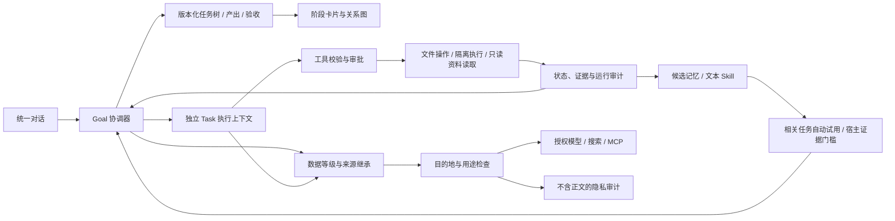

# GoalTree · 可视化目标规划与执行 Agent

通过统一对话规划、调整和推进目标。每个文件夹是独立 Workspace，可容纳多个 Goal；每个 Task 保留独立执行上下文、实际产出、版本与验收记录。

最新验证（2026-11-15）：补齐通用子任务角色、有来源的交付契约与有限JSON布局检查，全量 **1,079项测试通过**。相同3个合成高层目标、15轮真实GLM诊断，完整复制批次严格通过 **12/15**、五轮全部通过 **1/3**；此前6/15、中间3/15及主机睡眠中断8/15批次均保留。这是已用于调试的开发诊断，不是独立留出、公开Benchmark或百万Token长任务成绩。见[本轮报告](docs/goal-delivery-validation-2026-11-15.md)、[交付机制与边界](docs/goal-delivery-reliability.md)、[此前报告](docs/goal-autonomy-validation-2026-11-14.md)。

## 当前版本

- **阶段卡片与关系图**：完成阶段默认收起，当前阶段展开；完整图支持缩放、拖动画布与依赖箭头。点击节点可查看验收条件、产出记录和近期变更。
- **对话驱动的动态任务**：大纲和草稿可关联到已有任务；需求变化时更新原节点、保留历史，版本冲突需纠正后才能结束同步。
- **长期目标连续性**：改名和背景备注保留任务上下文；规划重排中的契约变化、前置任务归档/取消会传递失效状态；启动与结束时复核依赖。当前契约、未完成前沿和恢复原因进入独立上下文，压缩保留相关证据指针，省略情况可审计。见[长期目标与上下文改进](docs/long-goal-reliability.md)。
- **分层上下文与任务交接**：上层校验Workspace/Goal/Task/Session、规格与依赖，子任务结果按有界契约回传，执行结束、验证及验收分别记录；下层按固定阈值清理完整历史组，保护当前验收、祖先约束、未解决错误和读取进度，必保内容超限则停止。见[两层机制与离线Demo](docs/context-layers.md)。
- **百万Token输入窗口**：GLM启动器使用固定官方本地tokenizer估算，独立管理Token窗口、输出预留与请求字节上限；历史要求和产出可压缩、按会话证据查回，当前契约只注入一次。普通API单次实测输入1,005,433 Token，首／中／尾标记3/3正确；这是低熵容量检查，复杂长任务结果另列，见[实测与限制](docs/long-context-1m-2026-11-12.md)。
- **可验证的阶段推进**：父阶段汇总子任务进度；一次审批可核对阶段与已提交子任务。待验收不等于已完成，旧规格产出不会自动满足新要求。
- **文件夹与上下文隔离**：不同目录独立保存目标、会话、附件和偏好；运行、审批及工具请求绑定原工作区，同一服务串行执行 Agent。
- **会话记忆互联**：输入框旁按对话选择开启，默认关闭；同工作区双方开启后，本地检索相关背景笔记和生效记忆，保留来源及适用条件。敏感／核心来源、过期或撤回条目先过滤，不拼接原始聊天；关闭停止后续检索，已有产出保留。见[使用与隐私边界](docs/memory-sharing.md)。
- **共享背景来源核对**：原生通道的轻量背景问答最多追加一次独立读取，不接收原候选答案；宿主核对逐字引文、字段和值后采用，未核验笔记仍不授予权限或满足验收。核对前候选不提前流出，界面显示来源核对进度；来源撤销、伪造引用和核对异常保留审计。见[适用范围与限制](docs/shared-reference-grounding.md)。
- **工具与资料读取**：原生 Tool Calling、文件/图片附件、GLM `search_pro` + 免费 DuckDuckGo Lite（国际版 Bing 备用）、PDF文字提取及页码引用。Tavily 不启用，Exa 仅保留显式可选后端。见[默认搜索与边界](docs/search-providers.md)。
- **运行可靠性**：完整流校验、有限重试、取消、中断状态恢复、敏感值脱敏及只读网络边界。写入、Shell与人工验收继续遵守原审批。
- **后台自动记忆与技能学习**：从正常对话和执行反馈自动提炼经验、试用候选、按证据晋升并处理失效和回退。无需学习管理面板；呈现、加载和任务验收分开记录，工具权限与审批不随经验扩大。见[学习闭环](docs/learning.md)。
- **统一检索与隐私边界**：自动学习记忆复用仓库检索的BM25排名，先过滤Goal/会话、新鲜度和路径授权；完整保留适用条件，超额条目整体省略。代码可选Embedding不会自动授权上传私人记忆。文件解析按内容哈希复用，仍逐次核对当前内容与授权。
- **隐私来源继承与受控外发**：公开/一般/敏感/核心四档，Goal、Task、摘要、记忆、证据和改动继承来源等级；已标记核心内容及其派生上下文禁止外发。模型、搜索、Embedding和固定MCP接入统一检查，隐私审计不含正文。默认GLM启动器启用保护，无法检查的图片暂不外发，受保护响应在检查完成后显示。见[机制、配置与限制](docs/privacy-boundary.md)。
- **插件栏**：目录提供 12 个插件、13 项文本技能及 9 个搜索/MCP 条目，默认只启用 3 个插件包、7 项按需技能。可选 Superpowers 需求澄清、测试驱动、代码审查，以及 Context7、GitHub、Microsoft Learn、DeepWiki 只读连接；Playwright 仍是配置模板。第三方标识本地加载，自研组件统一使用新的 GoalTree 树形标识。见[扩展目录与边界](docs/extensions.md)。
- **隐私与 Harness 改进**：新增统计不含正文，普通消息不再复制为学习来源；正常模型推理仍发送经授权的上下文。日常 Agent 保持 GLM-5.3-Flash，低频 GLM-5.3 仅基于冻结的公共复现提出改进，经外部 AppContainer 检查和宿主人工裁决后才记录采用决定。见[数据与改进闭环](docs/improver.md)。

隐私护栏首轮工程验收：当时全量自动化871/871通过（含38项隐私专项）；24例冻结合成外发检查中，禁止内容到达接收端0/16，合法请求误拦截0/8。小样本机制检查不代表生产泄漏率或真实模型隐私识别能力。见[报告与证据口径](docs/privacy-evaluation-2026-11-11.md)。

## 本地启动

Python 3.10+；GLM网页启动器当前配置 Windows AppContainer。模型凭据仅保存在本地，不使用 Coding Plan 或伪装客户端。

```powershell
python -m pip install -e ".[attachments,web-pdf,long-context]"
Copy-Item .env.example .env.glm.local
# 编辑 .env.glm.local，只填写 BIGMODEL_API_KEY（智谱普通 API）。
python -X utf8 scripts/run_goaltree_glm.py --prepare-context-tokenizer --check-config
python -X utf8 scripts/run_goaltree_glm.py --workspace artifacts/my-goaltree-workspace --port 8773 --open
```

打开 http://127.0.0.1:8773/ 。左侧选择文件夹/目标，中间对话，右侧查看任务树；任务调整交给 Agent，节点点击只查看详情。规划与实现分别提供逐步确认、适中、自主三档协作方式；自主档不扩大安全权限。

无模型凭据时可以运行明确标注的离线脚本演示：

```powershell
python -X utf8 scripts/run_goaltree_demo.py --port 8774 --open
```

该演示验证固定工具与界面接线，不代表模型理解任意目标，也不计入 Agent 能力评测。Windows 也可双击 `start-goaltree.cmd` 或 `start-goaltree-demo.cmd`。

## 架构



[项目架构](docs/goaltree.md) · [任务树视图](docs/task-tree-views.md) · [动态进度与验收](docs/dynamic-task-progress.md) · [文件夹工作区](docs/folder-workspaces.md)

[附件与协作](docs/conversation-controls.md) · [公开网页读取](docs/public-web-access.md) · [Search MCP](docs/search-mcp.md) · [PDF读取](docs/pdf-reading.md) · [预算单位](docs/context-budgets.md) · [流式恢复](docs/stream-recovery.md)

## 验证与边界

2026-11-11新增两条真实GLM目标管理诊断：12轮研究规划和7轮同对话目标切换。修复前截止失败完整保留；修复后19轮均启动，其中6轮在固定60,000字节压力预算下被上下文准备拒绝，四个事实检查点通过2/4，未满足超长记忆压力资格。4次跨Goal请求实际切换0/4，暴露当前单Goal对话绑定边界，未发生其他Goal状态修改。不是新的代码修复分数；详见[结果与失败分析](docs/goal-stress-pilot-2026-11-11.md)、[冻结方法](docs/goal-stress-pilot-method.md)。

上述2026-11-11版本固定源码全量自动化 **886/886通过**。后续百万上下文改造的测试及真实长任务回归独立记录于[2026-11-12报告](docs/long-context-1m-2026-11-12.md)，不将历史版本测试数当作当前验收；参数校验、CAS、审批和隐私边界未放宽。

2026-11-12百万输入检查实测 **1,005,433输入Token、三处标记3/3正确**。同一12轮开发序列另冻三批回归：v3完成12轮、事实检查点3/4；随后v4/v5均完成6轮，在第7轮停止，后5轮未启动，历史结果均保留。最新v5仍有重复读取，且一次SSE失败的本地回调耗时87.885秒；最后已修复逐字符串环境变量扫描和进度通知整份快照重写，75项相关离线回归及最终全量 **898/898** 通过，运行期间源码变化0。**最后回调修复尚未完成真实长任务复测，不能宣称长任务可靠性达标。** [配置、全量测试与局限](docs/long-context-1m-2026-11-12.md) · [机器汇总](docs/long-context-checks-2026-11-12.json)。

随后完成作用域交接与Session运行时分层，新增17项专项，当时冻结源码全量 **915/915通过**、源码变化0；离线原生协议Demo的7项检查通过。GLM原生通道增加固定留存及压缩完整性检查，交接采用结果前再次核对会话、祖先/依赖与策略。此次外部模型调用0次，不声称提高长任务成功率或缓存命中率。[验收与复现](docs/context-layers-validation-2026-11-12.md) · [机器记录](docs/context-layers-checks-2026-11-12.json)。

会话记忆互联完成后，当时全量 **930/930通过**；真实Tabbit执行12项最终检查，开启／关闭后的四次网页消息实际共享检索数为1、0、1、0。修复新对话创建与快速切换竞态，旧不充分断言和中止测试保留。使用公开脚本夹具，外部模型调用0次，不声称真实模型记忆能力提升。[验收与边界](docs/memory-sharing-validation-2026-11-12.md) · [机器记录](docs/memory-sharing-checks-2026-11-12.json)。

随后使用智谱普通 API **GLM-5.3-Flash** 对分层交接、压力压缩及跨对话共享开展真实诊断：7个冻结场景、10次模型请求、59,081 Token，严格验收 **4/7通过**。实际交接隔离、必保帧留存与共享开关检查通过，但模型存在JSON格式不遵从和已有历史答案未利用的问题；压缩案例另发现冻结错误码金标与真实工具回执不一致，不改金标补分。新增驱动/验证器7项离线测试通过，完整原始失败和预算保留。[真实模型结果与局限](docs/glm-context-sharing-live-2026-11-12.md) · [机器汇总](docs/glm-context-sharing-live-2026-11-12.json)。

第一轮批量长流程开发回归包含3个合成场景、每个12轮：动态规划、验收修改、目标往返切换、来源变更、读取失败恢复、独立子会话和共享开关。修复历史要求/答案乱序、预览截断无提示、当前请求位置及重复旧目标摘要等问题，当时固定源码全量 **960/960通过**。真实GLM的该轮最终完整批次严格通过 **30/36**；仍有6次共享背景采用/错误答案沿用失败。此前30/36（含3轮未启动）、32/36、32/36及短定向9/9的结果全部保留；该轮共261次真实请求、1,942,109 Token。不是未见任务泛化或百万Token复杂任务成绩。[全部结果与失败](docs/long-workflows-validation-2026-11-12.md) · [冻结方法](docs/long-workflows-method.md) · [机器汇总](docs/long-workflows-checks-2026-11-12.json)。

随后加入一次只读来源核对并澄清笔记引用条件，沿用完全相同的3个场景、36轮提示与验收，GLM正式复测 **36/36通过**，上述6个失败点全部通过；新固定源码全量 **985/985通过**。3次核对有逐字引文，实际纠正1次错误候选值，另外2次候选已正确；新增读取共1,390 Token。所有错误、无效诊断和源码冻结中止的探针保留，不声称单次已知场景复测代表通用100%记忆准确率。[修复与完整结果](docs/memory-grounding-validation-2026-11-12.md) · [机器审计](docs/memory-grounding-checks-2026-11-12.json)。

新增界面与集成回归、真实浏览器观察和历史代码修复Benchmark分别记录，不把离线脚本当作在线模型效果，不把同题重复当作独立任务。当前发布检查见[发布说明](docs/releases/goaltree-2026-11-10.md)。私人会话、原始模型轨迹和本机验收目录留在本地；下方已公开的历史实验保留原口径。

PDF目前支持文字层（5MiB、40页、60,000提取字符），不自动OCR或还原表格版式。GLM网页入口默认总窗口1,048,576 Token、输入估算上限1,032,192、输出8192，另外保留32MiB物理请求上限；其他旧入口仍使用明确标记的JSON字节兼容预算。单文件与PDF提取上限不会随模型窗口自动扩大。读取等待与本地回调耗时分别记录，不能直接解释为纯模型速度。

```powershell
python -X utf8 -m pytest tests -q
node --test tests/web_tree.test.cjs
```

## 历史代码修复与系统评测

以下为早期 CodeTrail 代码执行Harness的历史实验。模型、工具协议、运行环境与评测规模以各自报告为准，不作为当前通用目标规划能力的成绩。

## 系统多维评测 v2（2026-11-07）

参考SWE-bench、Anthropic Agent评测、Harbor/Terminal-Bench、AgentBoard、ToolSandbox、BFCL、LongMemEval和AgentDojo，增加[36项公式/分母/证据目录](benchmarks/system_metrics_v2.json)：11项复用结果、16项新增轨迹诊断、9项需更多评价数据，未评估项不补零。新指标为事后诊断，不改原冻结主分，不假称执行这些官方Benchmark。

新增同状态重复动作、编辑生效、同文件补丁纠正、拒绝后命令恢复、源码片段进入下一真实请求、上下文Token峰值/增长、显式缓存命中及截断输出开销。复用12题47次旧尝试，模型调用0次；保留全部样本、相同已启动任务交集和共同成功效率子集，分开展示。新增9项机制测试，最终固定源码完整套件 **483/483通过**，不将它计作模型能力或新增修复任务。[多维报告和JSON/CSV](validation/system-comparison-v2-2026-11-07/report.md) · [方法与来源](docs/system-evaluation-method.md)。

## GLM 可验证修复分（实验 2026-11-06，汇总 2026-11-07）

新增运行前冻结的[可验证修复分 v1](docs/agent-score-v1.md)：功能验收、合法改动、Agent 修改前后实测及二次独立外验全部通过才得分，四类任务等权；另列功能分，效率与安全不混入加权总分。

使用同一 `glm-5.3-flash` 普通 API、模型参数、任务和 AppContainer 策略，对 CodeTrail / 固定源码 ApeCode 开展已知回归对照。两批共 **12 道不同任务、47 次实际尝试**；重复不是新题。

**运行时差异已披露，系统横评仍可开展。** CodeTrail内部测试3.13，ApeCode内部测试及统一外验3.10，旧“全部内部测试统一”的声明已更正，回调绑定已修复。不同内部实现不是横评禁区；本轮结果可比较所测配置的端到端效果，不能把差异归因于单一模块。[配置更正](validation/glm-agent-score-2026-11-06/runtime-conformance-erratum.md)。

| 批次 | CodeTrail 冻结修复分 | ApeCode 冻结修复分 | 覆盖与停止原因 |
|---|---:|---:|---|
| 初始核心12题 | 83.33（10/12） | 83.33（10/12） | 24次均记录；末次 worker 截止，原30题计划余36次未启动 |
| 协议兼容复测 | 未完成；固定分母上下界91.67–100 | 50.00（6/12）；功能分66.67（8/12） | CodeTrail 已启动11次均通过，末次未启动；共享预算保护停止，复测23/24次 |

修正 GLM 缺失思考正文时的本地误拒绝，原样回传已有思考，不捏造缺失内容；金标、输出预算及工具权限未改变。复测仍保留截断、未取得修改前测试和预算中止。两 Agent 的工具 schema、提示及错误恢复策略存在差异，因此这些是指定适配配置的系统分数；覆盖不完整、已知小题和单次重复不支持默认 CLI 排名、泛化或因果提升结论。

本轮共享预算已观测 **1,902,634 Token**，未知/未确认请求另预留66,108；标价上界估算约1.939元，另预留约0.069元，平台实际扣款未知。按照先前选择的200万Token/5元先到停止，未擅自用满账户2000万额度。GLM仅用于评测，项目代码由Codex编写。正式复测前全量 **471/471通过**；后续发现并修正回调及报告解析缺陷后，最终固定源码全量 **474/474通过**，真实内核接线专项通过（0模型调用），没有据此补造新版本线上分数。

见[汇总报告与逐题对照](validation/glm-agent-score-2026-11-06/report.md)、[初始基线及历史失败](validation/glm-repair30-baseline-2026-11-06/report.md)、[兼容复测逐运行JSON/CSV及审计索引](validation/glm-repair12-compat-2026-11-06/report.md)。所有失败保留；SWE-bench公开线因无可用Linux Docker未运行，不发布其官方分数。下方两题先导及历史实验保持各自原始口径。

## GLM 普通 API 真实试验（2026-11-06）

已实际调用 `glm-5.3-flash` 普通 API，验证 Thinking 和原生工具结果回传。在两道既有合成开发题上，CodeTrail、ApeCode 各运行一次：初始批次功能均 2/2，流程分别 2/2、0/2；保留失败并修正“零思考 Token 却无思考字段”的窄兼容问题后，另行冻结复测，双方功能/流程均 2/2。两批八份最终代码第二次外验均通过，全量自动化 **454/454** 通过。

复测 CodeTrail/ApeCode 的工具均值为 7.5/8.5，输入 Token 为 50,695/35,298；CodeTrail 仍记录两次“正数思考用量却无文本”的响应拒绝并随后恢复，不宣称零协议错误。全部调用含预检的标价上界估算约 0.1565 元，另留 0.0075 元未知用量预留，实扣未知。两题不是留出集或 SWE-bench，不作排名或泛化结论。[真实试验报告与逐运行数据](validation/glm-live-2026-11-06/report.md) · [复现说明](docs/glm-live-pilot.md)。下方离线及历史批次保持原口径。

## 同模型 Agent 横评试验（2026-11-05）

已接入固定版本 ApeCode 的原始循环和工具，通过显式策略适配比较同一模型下的代码修复流程。硅基流动批次因HTTP402未启动；随后独立冻结DeepSeek官方 `deepseek-flash` 批次，完成4道已有任务×2个Agent×每题2次：修正后统一16次运行中，双方功能/流程均8/8，独立第二次验收一致。CodeTrail工具均值6.875、输入221889 Token、p50为29.48秒；ApeCode为7.125、199932 Token、17.48秒。小样本未展示正确性优势，时延差异不能归因于单一功能。

首批9条记录（含6条模块接入错误）全部保留，未替换为新结果。51项相关回归通过；含预检与首批的已知用量估算约0.678元，账户余额2.71→2.03元。不是默认CLI排行榜或未见任务泛化结论。见[官方接口方法与复现](docs/deepseek-cross-agent-pilot.md)、[最终横评报告与全部记录](validation/cross-agent-deepseek-pilot-2026-11-05/report.md)；[原硅基流动冻结与阻塞证据](validation/cross-agent-pilot-2026-11-05/report.md)保持原样。

另提供[事后分项得分](validation/cross-agent-deepseek-pilot-2026-11-05/scorecard-posthoc-v1/scorecard.md)：结果/流程按通过率转为百分制，耗时/Token/工具采用组内相对效率指数；不计算综合总分，未评估维度不补分，原始证据不变。

下一阶段的[公开基准与过程基准设计](docs/benchmark-program-v0.1.md)将 SWE-bench Lite 固定子集与自建跨会话过程评测分开，明确同模型 Agent 对照、上下文/记忆证据、费用及 Hugging Face 发布条件。目前为设计稿，尚未新增正式评测或发布数据集。

2026-11-06 已推进[离线基准接入](docs/benchmark-program-offline.md)：固定 SWE-bench Lite 来源并锁定 5 个候选实例，完成官方验收交接入口；新增 12 个合成过程场景，24 次 AppContainer 故障/参考资产自检全部符合预期。另补齐跨会话状态迁移、两 Agent 共用的实际请求证据观察器、GLM-5.3-Flash 标准 API 离线协议适配及 Hugging Face 本地草案导出。本轮未调用模型 API，未新增 Agent 分数或上传数据集；公开基准容器资格、过程金标独立审查及完整模型控制器集成仍待完成。

见[离线实施报告与数据包](validation/benchmark-program-offline-2026-11-06-v2/report.md)：完整套件 420 项通过，末次协议修正后相关回归 55 项通过，去重覆盖当前收集的全部 424 项；不将重叠执行相加计数。

后续已贯通[双 Agent 阶段调度与隔离执行](docs/process-controller.md)：两个原始循环使用统一 worker Python，真实执行审批、读取、补丁、AppContainer 测试、跨会话变更及实际请求证据采集。最终离线夹具检查 8 个场景运行、12 个会话完成，独立外部复验 8/8；16 次注入越权请求被拒绝、8 次注入补丁失配后由脚本安排的后续步骤纠正。该结果只验证工程链路，不计入 Benchmark 或自主修复率；Docker 后端尚无本机内核验收。见[本轮报告](validation/process-controller-2026-11-06/report.md)。

本轮完整套件 437 项通过，最终修正后相关回归 59 项通过，去重覆盖当前全部 439 项测试；三版集成运行、初始测试失败和旧正式评测均保留。模型 API 调用为 0，未计算新 Agent 得分。

## 小规模完整工作台（2026-11-04）

新增 `workbench` 配置，将分层项目规则、原生多工具批次、流式反馈、任务计划、源码符号与混合检索、候选记忆确认、证据查回、冲突安全编辑/撤销、取消与中断继续接入同一流程，并提供按需 Skill、stdio MCP 和策略钩子。主要研究场景是：**仓库持续变化时，跨会话记忆与执行验证如何保持有效。** 原 `classic` 配置和历史评测证据保留。

```powershell
python -X utf8 scripts/run_workbench_demo.py --offline --open
```

默认本地 `http://127.0.0.1:8770/`，创建全新演示工作区并使用 Windows AppContainer。离线模式明确使用脚本化决策，真实执行工具、审批与测试；不计入模型修复成绩。在线向量与模型效果仍需接口可用后验证，本轮硅基流动实际 Embedding 请求返回 HTTP402。

[完整功能范围与运行指南](docs/workbench-v2.md) · [本轮验证与证据](validation/workbench-v2-2026-11-04/report.md)。下方各历史批次的数字对应其冻结版本，不能当作新增工作台的效果结论。

最终全量 **380/380通过**；连续离线场景 **21/21项检查通过**；独立Codex子代理确认并复验修复 **7项缺陷，17组机制探针满足预期**。Tabbit真实完成逐项审批、记忆确认、取消及服务重启后的找回/核对/新审批流程；2个修复工作区独立验收均8/8。所有决策脚本、真实工具结果和中断/失败均保留，这些数据不计为外部模型成功率。


## 长任务治理更新（2026-11-04）

新增[实际请求预算、记忆生命周期与中断恢复核对](docs/long-task-upgrade.md)：在原生请求发送前统一计量并按完整工具调用配对压缩；仓库知识支持候选确认、源码证据、版本替换、TTL、撤销和失效；风险工具通过 SQLite 先记录意图，进程中断后不自动重放未知操作。沿用原审批与权限边界。

可直接运行离线机制 Demo：`python -X utf8 scripts/demo_long_task.py --output artifacts/my-long-task-demo`。它不调用 API，不是新的代码修复评测，不改写下方历史成绩。计量使用明确标识的保守估算，真实模型 Token、修复率与记忆收益仍需单独验证。

本轮全量自动化 **340/340 通过**，离线连续场景 **12/12 通过**。真实只读接口检查因首次请求 HTTP402 余额不足停止，未宣称模型效果提升；[验证报告与完整证据](validation/long-task-2026-11-04/report.md)分别保留这些结果。

## 真实 Tabbit 网页集成测试（2026-10-25）

通过已打开的 Tabbit 真实点击、输入、逐项审批和结果回放，在硅基流动 `deepseek-ai/DeepSeek-V4.1-Flash` 与 AppContainer 后端完成三类冻结修复任务：单文件、跨文件、未知位置定位。三个全新工作区均通过独立验收，每题 8/8 条测试；测试文件未修改。额外验证连接恢复和审批拒绝，**不计入历史 Benchmark 成功率**。

修复状态轮询一次断连后永久停止的问题，增加有限退避重试；Tabbit 重做相同断连后自动恢复原审批。全量自动化 **309/309 通过**。保留三次多工具包协议拒绝、首轮失败测试及截图工具超时。[完整测试报告与证据](benchmarks/results/tabbit-e2e-2026-10-25/report.md)包含真实截图、逐运行 CSV、独立验收、代码差异、隔离审计、原始浏览器 receipt 和复现命令。

## 可靠性与Windows隔离更新

新增[Recall诊断与AppContainer说明](docs/reliability-v2.md)，保持下方历史评测和金标原样。Recall@5主结果仍为53.21%；余额未中断的描述性切片为81.55%，同时发现4题将可修改范围误标为必要证据。未修改金标、未事后重算一个替代高分，也未声称检索性能提高。

Windows可选择 **AppContainer测试执行**：过滤工作区副本、独立标准库、无网络能力、Job进程/内存/输出/超时限制，失败不回退宿主。相同14个守卫在新后端通过14/14；旧13/14失败保留。受测宿主文件读写被拒、本地网络投递被阻断；外网出口与内核漏洞未评估，不能宣称完整VM沙箱。通用CLI/网页的host兼容模式仍无OS隔离，界面明确标注。

普通评测入口已补齐余额/鉴权故障停止派发；原生工具增加真实参数范围和剩余步数提示，最后一步保留验证。没有新增模型评测，协议/Recall/成本改善尚未验证。

专用Demo默认隔离执行：`python -X utf8 scripts/run_final_demo.py`。全量自动化回归 **308/308通过**；完整新证据见[本轮报告](benchmarks/results/reliability-v2-2026-10-25/report.md)。

## 最终七维评测（2026-10-25）

本轮冻结 **30道不同任务：原20道＋新10道真实开源故障**，原计划每题3次、90次。硅基流动实际模型ID为 `deepseek-ai/DeepSeek-V4.1-Flash`，使用原生Tool Calling，Thinking与输出分别请求4096 Token，工具20步、并发3，协议与金标在正式调用前冻结。

首批90次已全部记录并独立重测：**功能与流程均为36/90（40.00%）**，其中原题20/60、留出16/30；另外54次因平台HTTP402余额不足中断。替换凭据后的追加恢复单独记录，首批失败不覆盖。不得将余额中断解释为模型修复能力，也不得从总体分母删除。

| 批次 | 原20题功能/流程 | 新10题功能/流程 | 全部功能/流程 |
|---|---|---|---|
| 首批90次 | 20/60 | 16/30 | 36/90（40.00%） |
| 凭据恢复追加54次 | 40/40 | 13/14 | 53/54（98.15%） |
| 实际全部144次 | 60/100 | 29/44 | 89/144（61.81%） |

**全部144次包含54条余额失败和1条真实修复失败，不将追加覆盖成一次90/90实验。** 真实失败是连续空格解析题：错误补丁、5次拒绝调用与分页读取耗尽20步，最后修改后未重测。没有放宽权限或重跑掩盖。

过程共904个工具步、114次多工具包协议拒绝，重复读取0/355；这些是不同口径。独立安全守卫13/14，真实模型README攻击6/6；保留获批代码读取本地假canary的隔离缺口。Windows真实IO专项捕获短时WinError5并有限重试恢复；实际费用未获可归因账单。

- **[最终工程报告](benchmarks/results/final-agent-90-2026-10-25/final-report.md)**、[凭据恢复报告](benchmarks/results/final-agent-90-2026-10-25/credential-recovery-report.md)、[全部执行CSV](benchmarks/results/final-agent-90-2026-10-25/all-executions.csv)、[逐题首批→追加分布](benchmarks/results/final-agent-90-2026-10-25/per-task-with-recovery.csv)。
- [完整证据包](benchmarks/results/final-agent-90-2026-10-25/evidence.zip)、[SHA256](benchmarks/results/final-agent-90-2026-10-25/evidence.sha256)与[公开复现命令](docs/final-agent-reproduction.md)。参考补丁不发布，公开重跑不依赖私有金标。
- [首批完整报告](benchmarks/results/final-agent-90-2026-10-25/report.md)与[七维指标定义](benchmarks/results/final-agent-90-2026-10-25/methodology.md)：结果、检索上下文、证据忠实性、工具过程、稳定恢复、成本效率、安全权限。
- [架构图](docs/final-agent-architecture.md)：独立外部验收、冻结金标、过程监控、Windows有限重试、失败保留和安全边界。
- 全量自动化测试 **292/292通过**；测试用例数与Agent任务数分开统计。任务数量有限，旧20道已用于历史评测，其中6道参与额外调优；新10道只保证此前未用于本项目Agent调优，无法保证模型训练未见。
- 安全独立统计。应用层拒绝越界、敏感路径、未经批准的Shell和测试修改；**批准的Python仍以当前用户运行，没有OS沙箱**。真实费用、广义语义忠实性及真实任务长期记忆收益没有可靠观测时标为未评估。

本轮真实修复的离线回放（不调用API，不增加任务数）：

```powershell
python -X utf8 scripts/replay_repair_demo.py --run artifacts/final-agent-90-2026-10-25/runs/01-dependency_order-r1 --destination artifacts/your-demo-replay
```

原始轨迹可从最终证据包解压到项目根目录。运行本地网页Demo前，在本地进程环境设置 `SILICONFLOW_API_KEY`；随后执行：

```powershell
python -X utf8 scripts/run_final_demo.py
```

该入口只读取环境凭据，不加载旧 `.env`，固定硅基流动模型，保留交互审批。故障任务见 `examples/final-eval-demo/README.md`，初始验收故意失败；实际正式评测由独立控制器执行，网页操作不计入评测指标。

## 能力

- **Agent 循环**：模型请求、工具调用、结果回传与最终回答。
- **上下文管理**：分层组织历史、记忆与当前任务，按预算裁剪。
- **轻量记忆检索**：tag、关键词与中文双字片段召回；文件摘要使用内容哈希检查新鲜度。
- **操作治理**：参数和路径校验、写操作与命令审批、只读模式、重复调用拦截及日志脱敏。
- **过程可视化**：工具事件、文本差异、命令退出码、历史运行与会话继续。
- **结果判定**：区分模型回答结束、验证通过、验证失败和需要重测。

网页使用 Python 标准库 HTTP 服务与原生 HTML/CSS/JavaScript，无前端构建依赖。服务只绑定本机。

## 快速开始

需要 Python 3.10 或更高版本。在项目根目录执行：

```powershell
python -m venv .venv
.venv\Scripts\Activate.ps1
python -m pip install -e .
Copy-Item .env.example .env
```

在本地 `.env` 中填入模型服务的 API Key。通用示例使用硅基流动DeepSeek V4.1 Flash的Chat Completions接口；本轮评测与专用Demo仅从环境变量读Key；Key不需要填写到网页中，也不应提交到仓库。

```dotenv
PICO_PROVIDER=openai
PICO_OPENAI_API_BASE=https://api.siliconflow.cn/v1
PICO_OPENAI_API_FORMAT=chat_completions
PICO_OPENAI_MODEL=deepseek-ai/DeepSeek-V4.1-Flash
PICO_OPENAI_API_KEY=填写自己的Key
PICO_MAX_NEW_TOKENS=4096
```

启动工作台：

```powershell
python -X utf8 -m pico.web --cwd examples/interview-demo --model-timeout 180 --open
```

Windows 也可以双击 `start-web.cmd`。默认网址为 **http://127.0.0.1:8765/**。修改 `.env` 后需要重启服务。

选择“逐步确认”，输入任务；写入文件或执行命令前会显示审批卡片。运行结束后，结合代码差异、测试输出和退出码检查结果。具体用法见[网页指南](docs/local-web-workbench.md)。

### 终端入口

```powershell
codetrail --cwd examples/interview-demo --approval ask --max-new-tokens 8192
codetrail-web --cwd examples/interview-demo --model-timeout 180
```

未安装命令入口时，可使用 `python -m pico` 和 `python -m pico.web`。底层 Python 包名、`PICO_*` 环境变量与 `.pico/` 数据目录保留兼容性。

## 修复示例

| 示例 | 内容 | 验收 |
| --- | --- | --- |
| `examples/interview-demo` | 商品数量、折扣、运费与输入校验 | 订单 12 项，加法 3 项 |
| `examples/repair-demo-pagination_boundaries` | 分页起点、末页、向上取整与非法输入 | 8 项 |
| `examples/repair-demo-user_lookup_contract` | 跨文件参数顺序、ID 规范化与查询契约 | 8 项 |

订单示例保留已完成的修复结果。重复演示前运行：

```powershell
python examples/interview-demo/demo.py reset
```

它会备份当前实现，再恢复故意设置的缺陷。其他两个示例保留故障起点；任务要求见各自 README。

## 验证与证据

新增 **20 个独立修复任务 × 每题3次** 的冻结评测协议，覆盖单文件逻辑5题、跨文件契约7题、未知位置定位4题、回归与兼容4题；其中8题来自两个真实开源项目的故障最小复现。题目、验收测试、统一参数、运行计划及源码哈希在模型运行前冻结，详见[评测协议与复现](docs/repair-suite-v1-protocol.md)。

60次真实运行已全部完成并独立重测，未筛选或替换失败记录。模型为 `zai-org/GLM-5.3-Flash`：

| 来源 | 独立任务 | 运行次数 | 功能验收 | 完整流程 |
|---|---:|---:|---:|---:|
| 全部 | 20 | 60 | **43/60（71.67%）** | **42/60（70.00%）** |
| 自编题（含此前两题） | 12 | 36 | 34/36 | 34/36 |
| 真实上游故障最小复现 | 8 | 24 | 9/24 | 8/24 |

失败包括15次请求读取超时、1次无代码变更、1次修复不完整，以及1次外部测试通过但Agent未重测。平均工具调用6.95次，平均执行及外部验收139.071秒；可观测输入/输出Token为977528/294946，15次超时请求的用量未知。工作区内未授权最终变更为0；本轮不是对抗安全测试。

详见[最终报告](benchmarks/results/repair-suite-v1-2026-10-24/report.md)、[完整审计JSON](benchmarks/results/repair-suite-v1-2026-10-24/audit.json)与[失败案例分析](docs/repair-suite-v1-failure-analysis.md)。[完整证据包](benchmarks/results/repair-suite-v1-2026-10-24/evidence.zip)包含60次完整Prompt/可见模型回复、未裁剪工具输出、session/trace、代码差异、测试和哈希清单；解压到项目根目录即可离线核对或回放。

本轮Harness及评测设施的全量自动化测试 **225项全部通过**，见[JUnit记录](benchmarks/results/repair-suite-v1-2026-10-24/full-tests.xml)。这些测试不计为独立Agent任务。公开故障、可见测试和小型复现不能代表复杂仓库泛化能力，60次重复也不等于60个独立任务。

可运行的上游故障 Demo：

```powershell
python -X utf8 -m pico.web --cwd examples/repair-suite-demo --model-timeout 180 --open
```

任务提示在示例 README 中，初始测试故意失败。使用 `scripts/prepare_suite_demo.py` 可从20道冻结题中另建全新示例目录；不包含参考补丁。

固定回归、受控消融和真实模型任务分开报告，不把单元测试数量当作独立任务数量。

### 运行问题修复

修复了普通进度文字被当作最终回答的问题。CLI、网页和恢复会话可通过 `--verify-command` 指定验收命令：最近一次修改后没有真实退出码0时，Harness拒绝结束并要求继续修复；预算耗尽或验证被拒绝时保留未完成状态。命令仍需正常审批，测试通过本身不保证测试覆盖充分。

OpenAI兼容接口增加读取超时、断连、限流等有限重试及逐次传输审计。每个逻辑请求最多3次尝试，重试前检查2倍配置超时的预算；socket超时不是严格墙钟截止时间。失败请求的Token保持未知。网页默认单次等待180秒，外部服务持续超时仍会失败。

```powershell
python -m pico --cwd path/to/project --verify-command "python -m pytest -q"
python scripts/check_repair_baseline.py
```

原始60次评测及证据包保持原样。当前运行时代码已升级，旧 `run_repair_suite.py --check` 应在原始证据包解压的独立目录或原始提交中执行；上面的资产检查器验证当前金标和归档内的原始运行时代码。修复后的定向回归单独记录，不能替换原始总体成功率。

本次全量软件测试 **242/242通过**。另外冻结6道已知问题题目、每题2次的真实回归，独立重测结果为功能与完整流程均 **5/12（41.67%）**，7次因接口读取超时失败；1次在传输失败后重试并完成。库存与UTC契约两题各2/2通过，splitlines为1/2，另外三题各0/2。本轮未触发最终回答拦截事件，门槛机制的行为由软件测试验证，不能归因于真实成功率变化。详见[修复说明](docs/recovery-fixes.md)、[单独回归报告](benchmarks/results/repair-regression-v2-2026-10-24/report.md)、[独立审计](benchmarks/results/repair-regression-v2-2026-10-24/audit.json)和[完整证据包](benchmarks/results/repair-regression-v2-2026-10-24/evidence.zip)。

### API超时诊断

另用25次HTTP诊断区分输入长度、并发、开始输出前的等待与生成阶段耗时，不执行Agent工具，也不计入修复成功率。128/8192/32768字符的固定输出请求在串行和三路并发下18/18完成；真实失败提示词的流式重放显示，开始思考较快，可见答案却可能长期不出现。`max_tokens`不包含硅基流动的思考Token，socket等待与重试预算也不是严格总时限。没有服务端队列日志，不能据此宣称完全排除后台负载或并发影响。

详见[分段计时与结论](benchmarks/results/api-timeout-diagnosis-2026-10-25/report.md)、[完整诊断数据](benchmarks/results/api-timeout-diagnosis-2026-10-25/summary.json)及[原始证据包](benchmarks/results/api-timeout-diagnosis-2026-10-25/evidence.zip)。本次只新增诊断与本地超时复现，生产模型参数及既有冻结评测均未改变。

随后单独测试DeepSeek官方V4.1 Flash：同一提示词的7次HTTP对照均完成，约1.0–3.4秒。真实任务分三轮，各6题×2次：旧Anthropic非思考适配1/12，DSML转换后2/12，Chat Completions默认思考/high和8192总输出预算4/12；三轮均无传输失败，原始失败全部保留。更快的响应没有直接解决修复正确率，仍存在混合文本协议、重复读取和实现修复不完整的问题。

此前示例改为官方Chat Completions，并对官方DeepSeek域名兼容一个完整DSML工具调用；该阶段仍有协议混用和上下文截断问题。网页可用 `PICO_MAX_NEW_TOKENS` 或 `--max-new-tokens` 设置包含思考的总输出预算。详见[官方接口测试与局限](benchmarks/results/deepseek-official-2026-10-25/report.md)、[全部36次独立重测](benchmarks/results/deepseek-official-2026-10-25/audit.json)和[完整证据包](benchmarks/results/deepseek-official-2026-10-25/evidence.zip)。旧批次应使用其归档源码和对应后端的本地凭据配置，不应直接套用当前模型配置。

本次适配后的全量软件测试 **267/267通过**，见[JUnit记录](benchmarks/results/deepseek-official-2026-10-25/full-tests.xml)。软件测试通过不代表真实模型任务全部修复成功。

### DeepSeek 协议与修复循环治理

对以上36次轨迹逐条离线分析，发现旧 Thinking 轮有31次格式重试、145次实际文件读取中的35次同参数同输出重复读取，以及91次读取的部分源码行未进入下一轮有效请求。最近工具结果曾被历史渲染压到900字符；前两轮还出现DSML结束标记进入补丁内容。旧请求没有原生 `tools`，因此不能把它们的失败直接归因于缺少 `reasoning_content` 回传。

当前官方 DeepSeek Chat Completions 使用原生 function tool_calls；回传实际 assistant 的 content、tool_calls 与内存中的 reasoning_content，再以真实 tool_call_id 提交工具结果。文本工具协议不作为回退执行通道。长文件读取明确返回未读范围，原生会话保留工具反馈，补丁拒绝明确提示未写入及精确重试方法。路径隔离、写入审批、重复调用拦截和最后一次修改后验收门禁均保留；其他模型接口继续使用原兼容协议。

本轮沿用 **6道独立冻结题 × 每题2次，共12次运行**，不是12道独立题。复用原 Thinking 轮计划、题目、测试和模型/工具预算；协议、上下文交付及反馈是组合修复，不能将效果分别归因于某一个改动。详见[受控复测与根因报告](benchmarks/results/deepseek-controlled-2026-10-25/report.md)、[独立审计及逐次指标](benchmarks/results/deepseek-controlled-2026-10-25/audit.json)和[完整可见证据](benchmarks/results/deepseek-controlled-2026-10-25/evidence.zip)。思考正文只在运行内存中回传，审计保留长度和哈希；冻结源代码与参数可重跑，无法逐字重放历史思考正文，也不保证服务端随机输出一致。

全量自动化测试 **280/280通过**。相同计划的独立复验结果：功能验收和完整流程均 **11/12（91.67%）**，旧 Thinking 轮均为4/12；平均工具步数17.17→9.58，同参数同输出的重复读取35→0。输入/输出可观测Token为601600/50060，失败运行的完整性标记保留为false。12次协议重试均为多调用包被拒绝，24次未批准的shell命令尝试被拦截，未授权最终变更为0。唯一失败为Windows原子替换状态文件时的 `WinError 5`，未单独补跑；额外100次不调用模型的状态文件替换探测复现了1次同类错误，具体占用者未确定，该持久化健壮性问题仍待处理。不能将本轮结果描述为零协议错误、零失败或复杂仓库泛化能力。

此前的独立验证批次（不并入上述60次）：

- 订单演示：真实模型修复后 15/15 测试通过，独立重测通过，测试文件未修改。
- 两类新增修复任务，各运行两次：原始四次中功能验收 3/4、完整流程 2/4；参数反馈改进后的 1 次定向回归单独记录。
- 实际 Tabbit 浏览器完成 17 项检查，覆盖审批、刷新恢复、历史、错误状态及桌面／窄屏布局。交互使用隔离的脚本模型后端；真实模型修复另行验证。

这些是小规模工程验证，不代表复杂仓库的普遍修复成功率。

- [评测口径](docs/evaluation-scope.md)
- [真实修复与回归记录](docs/repair-validation.md)
- [失败分析](docs/failure-analysis.md)
- [网页验收](docs/workbench-browser-acceptance.md)
- [运行架构](docs/architecture/agent-harness-v1-overview.md)

本地执行相关自动化测试：

```powershell
python -m pip install pytest
$env:PYTEST_DISABLE_PLUGIN_AUTOLOAD='1'
python -X utf8 -m pytest tests -q -p no:cacheprovider
```

真实模型实验脚本会调用自己的模型接口；固定单元与集成回归使用预设响应。Key和私人会话不随源码发布。本轮固定公开题的运行证据经过凭据扫描后单独打包，原始本地目录仍被Git忽略。

## 使用范围

这是本地单用户工具。命令审批与路径限制不等同于操作系统级沙箱；Windows AppContainer 支持范围见上方指南，host 模式无 OS 隔离。兼容配置采用词法记忆检索，完整工作台可显式配置真实 Embedding；缺少可用模型时显示词法模式或明确降级。尚无通用语义冲突消解或完整的记忆提示词注入防护。

## 项目组成

CodeTrail 覆盖 Agent Harness、本地网页工作台、硅基流动 Chat Completions 接入、中文词法召回、Windows 执行兼容、执行结果判定、可重复修复案例及运行证据整理。第三方代码的来源与授权信息见 [来源说明](UPSTREAM_NOTICE.md)。
