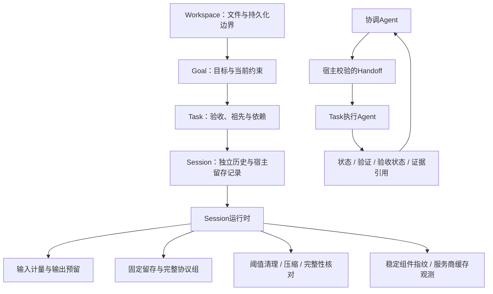

# 作用域与Session运行时

GoalTree把上下文管理分成两个职责：上层决定信息属于谁、交接给谁；下层决定当前窗口怎样保持有界。两层共用原有证据库、版本控制、工具审批和模型适配器，不依靠增加Agent数量修复窗口压力。



## 上层：作用域与交接

Workspace、Goal、Task、Session身份和所属关系由宿主维护，任务内容可以动态变化。`revision`用于并发控制，`spec_version`表示规格版本。Task执行沿用自己的Session，协调器不会复制整个父会话到子会话。同一Workspace仍共享文件，串行执行和原权限检查保持不变。

`pico/handoff.py`定义`task-handoff-v1`：

| 方向 | 必需信息 | 边界 |
|---|---|---|
| 下发 | Workspace ID、Goal/Task/Session绑定、规格版本、任务描述、验收条件、约束、祖先背景、依赖状态与摘要、指令、策略指纹 | 131,072 UTF-8字节；必需内容超限拒绝，不截断约束 |
| 回传 | Handoff ID、执行状态、完整验证结构、宿主验收状态、子运行绑定、工具步数、正文/错误片段、完整结果证据ID | 序列化JSON不超过3,400字符；只缩短可选正文/错误，标记截断 |

下发绑定必须与GoalStore当前绑定一致，不能把任意Session ID写入请求。交接包有内容摘要用于完整性核对；这是内部宿主收据，不是加密签名或外部不可信来源认证协议。

执行前和结果采用前均复核Workspace、Session、目标/任务规格、祖先与依赖契约及宿主策略。依赖失效或版本变化时拒绝采用结果，原始产出和失败证据保留。已有工具、Shell和审批权限不从交接正文获取。

三种状态分别保留：`status=completed`表示执行循环结束；`verification`表示配置验证器结果；`acceptance`表示GoalStore中的验收状态。人工任务可以执行结束但仍为`review`，不能因为回传了答案就标成已验收。

`handoff_dispatched / handoff_received / handoff_rejected`进入运行审计；完整交接包与子结果放在协调器会话授权范围内的证据对象中，模型只收到有界回传与引用。

## 下层：确定性运行时

workbench原生工具通道的协调器与Task执行器复用同一个`NativeContextBudget`和`session_context`，当前GLM网页走这条路径。classic及旧文本协议入口仍保留兼容行为，不将它们称为已迁移到同样的wire保护机制；宿主交接校验不依赖是否使用原生协议。

默认在有效输入预算的85%触发清理/压缩，目标降到70%。这两个比例是本项目的工程初值，不是所有模型的最佳阈值或上游默认值。有效预算沿用已有Token/字节模式及输出预留；GLM网页入口仍使用固定官方本地tokenizer估算，不以字节冒充Token。

处理顺序：

1. 验证工具调用与结果配对；协议不完整不发送。
2. 达到阈值后整体省略可选检索记忆。
3. 把旧的完整协议组替换为机械证据摘要，保留最近完整交互。
4. 可选预览和普通历史证据可按预算缩减；必保帧不进入此淘汰队列。
5. 比较压缩前后必保帧，记录摘要和完整性结果；必保内容与最新交互仍超硬预算时明确停止。
6. 只有取得完整模型响应后，才把压缩后的历史提交到本轮对话；请求超时不提交半成品。后续压缩读取已有结构化事件，不把上一份摘要再次当作普通文本总结。

压缩触发、保留类型和完整性检查均由宿主决定，无额外摘要模型调用。85%/70%只是软目标：必保状态可能使70%无法达到，记录`target_reached=false`；只要不超过硬上限就可继续，不能为了软目标删除约束。

### 固定留存清单

| 类型 | 留存与失效规则 |
|---|---|
| 当前请求、目标/任务验收、有效祖先约束 | 当前原文受保护；通过宿主版本更新替代，不由模型自由删减 |
| 宿主规则、隐私和权限边界 | 每次执行沿用原策略检查；历史文本不授予权限 |
| 未解决错误 | 宿主保留精确头尾片段、错误码、证据ID和输出哈希；明确记录省略字符数；完整原文在证据库 |
| 读取进度 | 按路径、源哈希合并实际返回行区间；保留各页证据引用；每次请求复核文件新鲜度 |
| 已修改文件 | 记录已发生的修改；不等于任务完成或允许重放 |
| 当前验证状态 | 每个新Run重置；上一轮成功不得验证当前轮 |
| 最近完整工具协议组 | 保留assistant调用及对应结果，不能留下孤立tool结果 |

错误按操作定位；成功的无关读取不会清掉失败测试。Shell结果必须有明确零退出码且没有验证过程修改文件，才能清掉同一操作失败。未知退出结果不能冒充恢复成功。规格变化进入新作用域时，旧范围记录不作为新任务的有效验证。

新对话创建首个Goal、当前Goal由宿主更新契约时，显式刷新留存绑定；这个路径不能把收据移交到另一个Goal或Task。Session ID错误、未经刷新而变更契约时拒绝。

读取覆盖证明的是过去确实返回了哪些行，不是模型已经理解，也不表示正文仍在窗口。源文件变化时标记`source_current=false`，不能把旧摘要当成新源码。未解决错误和读取进度也有体积成本；当前实现宁可明确停止，也不会声称可以无界留存。

### 多轮历史与实际请求顺序

历史要求与最近已完成产出的预览按真实Session序号交错排列；预览明确标记截断、原字符数和同Session证据ID。Workbench不把上一轮用户要求再次复制到当前请求中的工作状态摘要；当前用户要求、契约与权限仍优先，历史文本不能成为新的待执行指令。

为避免旧命令在位置上看似比当前问题更新，存在聊天历史时，实际请求顺序为：稳定system、历史、当前宿主状态/规则与已授权检索背景、唯一的当前请求、当前Run的完整执行交换。内部预算仍保护原始当前帧，审计用`protected_frame_wire_indices`映射到实际位置，并复核哈希/预算。纯工具运行不因产生压缩摘要而套用聊天历史排序；不能打散原生工具调用与对应结果。该排序不保证模型一定正确采用背景，真实失败单列于[长流程报告](long-workflows-validation-2026-11-12.md)。

### 缓存

保持system与工具定义等稳定组件，动态预算和任务状态单独注入；审计记录稳定组件摘要。摘要仅用于诊断，不表示服务商缓存命中。已经配置支持缓存的适配器沿用原缓存能力，不向GLM发送其他厂商专属参数。

缓存与容量是两个指标：缓存降低重复计算成本，不扩大窗口。新增`cache_usage_reported`和可空`observed_cache_hit`，仅服务商明确返回缓存Token时判定命中/未命中；未提供字段为未观测。旧`cache_hit/cached_tokens`兼容字段仍保留，不能用其默认零值宣称测得未命中。

## 复现与范围

```powershell
python -X utf8 -m pytest tests/test_context_layers.py -q
# 输出目录必须新建；脚本不会调用外部模型：
python -X utf8 scripts/demo_context_layers.py --output artifacts/my-context-demo
python -X utf8 -m pytest -q
```

Demo通过脚本指定原生模型响应，实际运行协调器、子会话、文件工具、证据存储与有界回传；另有独立小窗口压缩探针。它验证接线和边界，不证明模型会自主选对任务、长期记忆更准或端到端速度改善。

本轮没有付费模型调用，没有改写冻结长任务金标或历史实验。1M容量与此前真实长任务失败仍以[2026-11-12长上下文报告](long-context-1m-2026-11-12.md)为准；本次新代码不能直接继承历史模型成绩。[本轮验收](context-layers-validation-2026-11-12.md)。

参考成熟机制的职责拆分：[Claude工具上下文管理](https://platform.claude.com/docs/en/agents-and-tools/tool-use/manage-tool-context)、[阈值压缩](https://platform.claude.com/docs/en/build-with-claude/compaction-threshold)。这里只借鉴设计模式，没有移植其私有实现或把其服务端能力冒充GLM功能。
