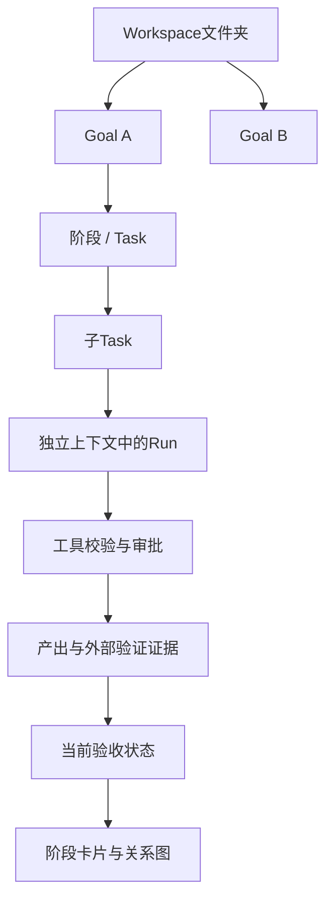

# GoalTree：多目标规划与执行架构

GoalTree以文件夹为Workspace边界，用Goal组织持续目标，用动态Task表达阶段与子任务，用Run记录一次实际执行。目标规划、执行与评测属于同一Harness的不同模块，评测不是产品的唯一入口。

## 交互与视图

页面保留三栏：左侧选择文件夹和目标，中间统一对话，右侧阶段卡片。用户无需选择自由聊天或规划模式；协调器根据请求调用结构化工具。普通问答不创建目标，规划请求不自动授权开始实现。右上可展开完整关系图，默认只显示父子关系，依赖另行展示。

节点由Agent维护，点击卡片/图只查看详情。浏览选择不改变正在执行的任务绑定。不同工作区拥有独立CSRF令牌、会话与状态，同一Web服务串行执行任务。

左侧插件入口提供插件、技能和MCP三个页签。插件包按需启停文本工作流；MCP只接固定只读服务，凭据留在宿主环境，检测状态与实际查询分开。自动学习技能只读展示，不增加人工学习管理步骤。见[扩展目录](extensions.md)。

## 状态与审计

GoalStore将状态变化与审计事件放在同一个SQLite事务中。revision用于并发检查，spec_version表示任务要求版本。父子关系不等于依赖关系；依赖可跨分支但不能跨Goal，两个关系均检查循环。每个工作区最多32个Goal、500个Task、50层关系深度；不是分布式多租户调度系统。

- goal_action创建/调整本目标任务；plan_tasks可新增层级任务。
- record_progress关联对话中的实际产出，只允许进行中或待验收，不自行批准完成。
- run_task进入独立执行上下文，父子共享本轮工具预算。
- confirm_task请求真实操作者验收，可一次核对阶段和已提交子任务，范围/版本变化则整批拒绝。

修改任务要求会保留旧会话和运行引用，旧产出不能冒充新规格的有效验收。仅补充目标背景备注或改显示名称不会让整棵树失效。更新父任务后若子任务版本变化，协调器必须核对当前版本并修复被拒绝的修改，不能静默覆盖。

## 上下文与执行边界

Goal协调会话独立，Task执行会话独立。模型获取当前目标、任务规格、相关依赖与已有产出指针；不将其他Goal的主观笔记自动混入当前目标。原生调用和结果以完整协议组保留，Thinking内容按接口要求在内存中传递，不以内部思考文本作为公开进度。

上下文管理分成[作用域与Session运行时两层](context-layers.md)：上层以版本化Handoff限制交接范围，复核祖先/依赖、会话和策略，并返回有界结果及证据引用；下层以固定阈值和留存清单管理窗口。当前验收、有效祖先约束、未解决错误片段、实际读取区间和验证状态受宿主保护，不由模型决定删除。必保内容超硬预算时停止，不以摘要悄悄替换。

协调器没有直接写文件和Shell能力，通过run_task分派实现。子执行器沿用工作区路径校验、内容版本检查、策略钩子和高风险审批。AppContainer对支持的Windows执行命令提供OS约束；工作区/会话隔离本身不能宣称为完整的多租户安全边界。

公开网页读取属于独立只读通道，Shell网络权限不会随之扩大。默认搜索采用GLM search_pro与免费国际来源，Exa保留为显式后端；详见[来源、预算与网络边界](search-providers.md)。PDF在有资源上限的独立解析进程中提取文字。解析器资源限制不等于AppContainer沙箱。

## 数据位置

默认GLM网页启动器为工作区启用四档隐私策略。来源等级沿Goal、Task、会话、记忆、证据和文件改动继承，模型/搜索/Embedding/固定MCP发送前检查目的地与用途。隐私审计不含正文，本地恢复记录单独管理；核心禁外发、检查故障拒绝、无法检查的图片拒绝及受保护响应缓冲均有明确边界。见[隐私机制与限制](privacy-boundary.md)。

后台自动学习复用私有知识库：宿主收据关联候选记忆/文本Skill，自动选取相关任务试用，按真实证据晋升、去重、修订和回退；不要求用户维护学习面板。Goal内经验不会自动传播到其他Goal；任务验收和工具审批继续独立生效。详见[记忆与技能学习](learning.md)。

跨Goal参考由独立[记忆互联开关](memory-sharing.md)控制，默认关闭、同Workspace双侧开启才可检索。仅共享有来源、有适用条件且检查通过的记忆／背景笔记，作为可清理参考帧，不提升为当前契约或验收。源Goal的私有会话、候选记忆和技能仍按原作用域管理；关闭不会自动删除已经生成的内容。

共享Harness的改进独立于Goal内学习：宿主本地采集固定字段指标，由操作者选择冻结公共案例，低频GLM-5.3只提方案；开发者实现后运行外部AppContainer检查，人工决定是否采用指定候选。无自动合入或后台原文上传，详见[数据与改进闭环](improver.md)。

每个工作区内部的.pico目录保存任务状态、会话、附件、证据、操作意图及运行记录；默认不提交Git。初始工作区的workspaces.sqlite3登记用户选择的文件夹，不搬迁或复制用户目录。运行绑定、浏览选择与模型服务配置分别管理。

服务重启恢复的是状态，已经完成的副作用不会自动重放。流式响应缺少完整结束信号时不接受工具调用；有限重试保留既有工具结果，未知Token保持未知。快照汇总和脱敏在任务锁外进行，避免增长中的历史阻塞流式接收。

## 验证与适用范围

配置的验证命令通过只能证明该命令覆盖的条件；研究文档等人工验收任务仍需用户核对。到达后续阶段不等于前序阶段已验收。图布局、浏览器交互、协议回归与真实模型任务正确率分别记录。

[当前发布检查](releases/goaltree-2026-11-10.md) · [动态任务与验收](dynamic-task-progress.md) · [任务树视图](task-tree-views.md) · [文件夹工作区](folder-workspaces.md)
