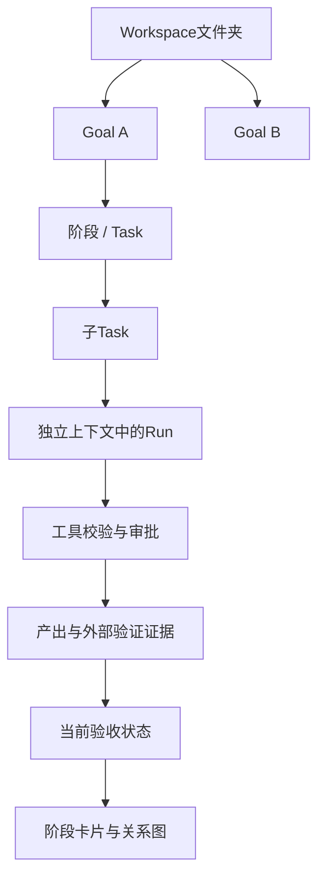

# GoalTree：多目标规划与执行架构

GoalTree以文件夹为Workspace边界，用Goal组织持续目标，用动态Task表达阶段与子任务，用Run记录一次实际执行。目标规划、执行与评测属于同一Harness的不同模块，评测不是产品的唯一入口。

## 交互与视图

页面保留三栏：左侧选择文件夹和目标，中间统一对话，右侧阶段卡片。用户无需选择自由聊天或规划模式；协调器根据请求调用结构化工具。普通问答不创建目标，规划请求不自动授权开始实现。右上可展开完整关系图，默认只显示父子关系，依赖另行展示。

节点由Agent维护，点击卡片/图只查看详情。浏览选择不改变正在执行的任务绑定。不同工作区拥有独立CSRF令牌、会话与状态，同一Web服务串行执行任务。

## 状态与审计

GoalStore将状态变化与审计事件放在同一个SQLite事务中。revision用于并发检查，spec_version表示任务要求版本。父子关系不等于依赖关系；依赖可跨分支但不能跨Goal，两个关系均检查循环。每个工作区最多32个Goal、500个Task、50层关系深度；不是分布式多租户调度系统。

- goal_action创建/调整本目标任务；plan_tasks可新增层级任务。
- record_progress关联对话中的实际产出，只允许进行中或待验收，不自行批准完成。
- run_task进入独立执行上下文，父子共享本轮工具预算。
- confirm_task请求真实操作者验收，可一次核对阶段和已提交子任务，范围/版本变化则整批拒绝。

修改任务要求会保留旧会话和运行引用，旧产出不能冒充新规格的有效验收。仅补充目标背景备注或改显示名称不会让整棵树失效。更新父任务后若子任务版本变化，协调器必须核对当前版本并修复被拒绝的修改，不能静默覆盖。

## 上下文与执行边界

Goal协调会话独立，Task执行会话独立。模型获取当前目标、任务规格、相关依赖与已有产出指针；不将其他Goal的主观笔记自动混入当前目标。原生调用和结果以完整协议组保留，Thinking内容按接口要求在内存中传递，不以内部思考文本作为公开进度。

协调器没有直接写文件和Shell能力，通过run_task分派实现。子执行器沿用工作区路径校验、内容版本检查、策略钩子和高风险审批。AppContainer对支持的Windows执行命令提供OS约束；工作区/会话隔离本身不能宣称为完整的多租户安全边界。

公开网页读取属于独立只读通道，Shell网络权限不会随之扩大。Exa Search MCP固定端点及工具schema，PDF在有资源上限的独立解析进程中提取文字。解析器资源限制不等于AppContainer沙箱。

## 数据位置

每个工作区内部的.pico目录保存任务状态、会话、附件、证据、操作意图及运行记录；默认不提交Git。初始工作区的workspaces.sqlite3登记用户选择的文件夹，不搬迁或复制用户目录。运行绑定、浏览选择与模型服务配置分别管理。

服务重启恢复的是状态，已经完成的副作用不会自动重放。流式响应缺少完整结束信号时不接受工具调用；有限重试保留既有工具结果，未知Token保持未知。快照汇总和脱敏在任务锁外进行，避免增长中的历史阻塞流式接收。

## 验证与适用范围

配置的验证命令通过只能证明该命令覆盖的条件；研究文档等人工验收任务仍需用户核对。到达后续阶段不等于前序阶段已验收。图布局、浏览器交互、协议回归与真实模型任务正确率分别记录。

[当前发布检查](releases/goaltree-2026-11-10.md) · [动态任务与验收](dynamic-task-progress.md) · [任务树视图](task-tree-views.md) · [文件夹工作区](folder-workspaces.md)
