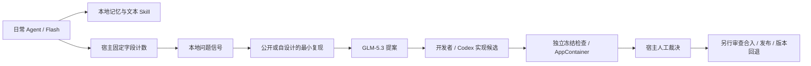

# 本地数据飞轮与 Harness 改进

日常协调、执行和候选记忆仍使用已有 GLM-5.3-Flash。新的 Improver 使用智谱普通 API 的 `glm-5.3`，只提出结构化方案，不操作工具、不应用补丁、不修改权限、不合入代码。实际代码由开发者/Codex实现，外部检查与宿主操作者作最终裁决。

本模块与模型训练分开：不微调权重；指标、经验、代码和测试的版本有独立记录。



## 数据边界

默认 `local` 模式：固定字段的本地过程指标和限定 Goal/会话的自动学习；不向分析平台上传。`off` 关闭新的学习与过程指标；`aggregate` 允许操作者显式导出汇总文件，没有后台 HTTP 上传器。这三个模式不改变正常模型推理、网页或 MCP 请求的授权范围。

运行指标直接投影自宿主事件：工具名映射到固定白名单，其他名称统一为 `other`；状态、错误类别、计数和用量使用固定结构。正文、参数、命令、路径、URL、栈和用户目标不进入指标库。相同成功 `read_file` 的 path/start/end 在单轮内用临时指纹统计重复；指纹不持久化。运行ID用工作区随机盐HMAC去重，不进入导出。

缺失 Token 记录为未知请求数，与已知 Token 总量分开。传输重试中未知消耗不会被计为零。`completed_runs` 仅表示回复结束；`verified_runs` 表示配置验证证据通过，不等于用户目标验收。父/子执行均可能成为 Run，汇总数不是独立任务数，不用于原有 Benchmark 分母。

本地 `opportunities` 在至少3次Run后给出固定公共案例的调查入口，依据仅为缺失用量、工具/模型错误计数；不推断因果，也不自动调用旗舰。操作者选择案例并显式 `request --live` 后才发起一次请求。当前 Improver 输入仅来自自带冻结公共模板，**不自动附带本地指标、聊天、附件、文件差异或记忆库**。指标可供本地开发者选题，公共案例需单独构造。

汇总导出至少需要10次Run，工具/错误/时长分桶的小计不足10时不展示。没有设备、用户或项目标识；这只是减少披露风险，不是差分隐私或形式化匿名保证。导出保留已知Token和未知请求数，不把总量写成零。

普通反馈的新学习来源只保存通用宿主收据，语义提取仍使用当前已授权模型请求中的消息。短小、明确要求记住的表达偏好可保留；常见凭据、邮件、电话、绝对路径及部分敏感格式会拒绝进入新增学习候选，候选 key/body 也受检查。自动生成的失败经验不再复制错误正文，流程Skill不再复制原始任务、路径或Shell命令。

上述检查是规则和最小化措施，不能保证识别所有商业隐私、身份信息或语义泄露；摘要、向量、Skill仍应视为敏感派生数据。历史学习记录、原始聊天、工作摘要、审计、检索索引及备份**没有自动删除或迁移**，它们继续按各自策略处理。`clear-metrics` 仅清理过程指标，不宣称删除会话或全部记忆。指标默认查询30天窗口（可设1–90天），写入时清理过期行；SQLite物理副本/备份并不由此获得彻底擦除保证。

## 固定模型与请求边界

- 标准端点：`https://open.bigmodel.cn/api/paas/v4`；模型ID `glm-5.3`。
- Chat Completions、Thinking enabled、reasoning_effort=max、temperature=1、top_p=0.95、JSON输出。
- 请求输入上限16KiB，输出上限4096 Token，传输最多1次尝试，客户端超时配置120秒。配置值不等于严格网络墙钟保证。
- 每工作区UTC日最多2次真实请求，失败/未知消耗也占次数；每份prepared提案只能派发一次。不是服务商账单或整个账户硬费用上限。
- 返回模型身份与完整 stop 结束必须确认；不接受截断结果，不切换模型或服务商。
- API Key仅从本地 `BIGMODEL_API_KEY` 或显式本地env文件读取；没有Coding Plan伪装。

请求前持久化公共证据包、SHA256、配置和调用预留。异常只记录阶段、类型和白名单传输状态，不复制服务端错误正文。缺失用量、实际费用保留未知。进程意外退出会留下requesting/started记录，审计展示unfinished_calls，不自动重发不确定请求。

官方参数依据：[GLM-5.3 文档](https://docs.z.ai/guides/llm/glm-5.3)。旗舰是否优于Flash仍需另外冻结对照；一次有效提案不能证明模型优劣或自动演化收益。

## 提案、验证、裁决

状态为 `prepared → requesting → proposed/failed → verified/verification_failed → accepted/rejected`。每次变更有修订号CAS和本机哈希链；这不是外部锚定的防篡改存储。宿主CLI是可信操作入口，不是带身份认证的多人审批服务，也不是模型工具。

提案必须给出根因假设、改动、允许的目标文件、验证要求、风险、回退方式及真实公共案例ID。未知字段、路径越界和不匹配证据拒绝。模型输出中的内容仍需审查，例如不能把拦截演示标记当作通用隐私保护。

验证器从基线和候选复制过滤后的pico/goaltree包，将相同的宿主unittest文件注入两个新目录；不执行候选自带测试，也不发送外部检查代码给Improver。沿用原AppContainer与精确unittest命令，无宿主回退或ACL放宽。记录源码差异、两份快照、检查文件哈希、逐检查状态及OS审计；只有退出码0、全部预期检查通过、快照未改变才通过。目标之外的文件变更不能获准。

正式检查采用运行时随机标记，防止只拦截公开样例字面量。验证结果分别记录功能、偏好回归和权限检查；三项检查不代表广泛泛化能力。运行不受信任的Python候选仍需人工审查奖励投机，哈希和沙箱并不能证明候选代码没有在内存中欺骗测试。

接受前重查快照与检查文件，且必须存在实际改动。人工accept只记录对指定候选哈希的决定，**不会合入、发布、覆盖工作目录或执行模型建议的回退命令**。后续源码改变需要重新验证；真实回退使用常规版本控制审查。

## 使用

```powershell
# 离线闭环，输出目录必须是新目录
python -X utf8 scripts/run_improver_demo.py --output artifacts/my-improver-demo

# 选择真实网页工作区文件夹；先查看本地信号和隐私设置
python -m goaltree.improver --workspace <workspace> metrics
python -m goaltree.improver --workspace <workspace> opportunities
python -m goaltree.improver --workspace <workspace> privacy

# 准备并查看冻结的公共证据包，返回 imp_... ID
python -m goaltree.improver --workspace <workspace> prepare --case feedback-minimization-v1
python -m goaltree.improver --workspace <workspace> show <id>
python -m goaltree.improver --workspace <workspace> request <id> --live

# Codex/开发者在独立候选中实现；输出目录必须为新目录
python -m goaltree.improver --workspace <workspace> verify <id> --version <version> --baseline <baseline> --candidate <candidate> --output <new-check-dir>
python -m goaltree.improver --workspace <workspace> decide <id> --version <new-version> --decision accept --note "人工审查结论"
python -m goaltree.improver --workspace <workspace> audit

# 自愿导出汇总：先按当前revision更新设置；不会自动联网
python -m goaltree.improver --workspace <workspace> privacy --mode aggregate --revision <revision> --days 30
python -m goaltree.improver --workspace <workspace> export-metrics --output <new-file.json>
python -m goaltree.improver --workspace <workspace> clear-metrics --confirm
```

[本轮实现与验收](improver-validation-2026-11-11.md)。此功能不是新增公开代码修复Benchmark，保留既有实验及失败。
