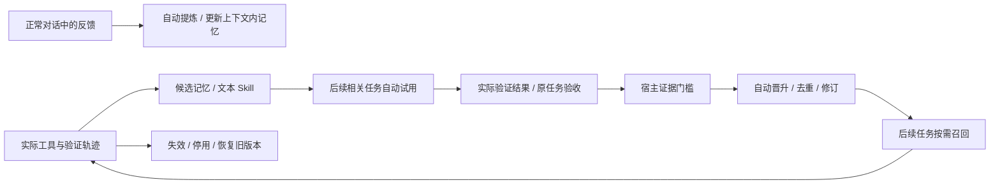

# 后台自动记忆与 Skill 演化

GoalTree 自动把实际执行反馈沉淀为可追溯记忆和文本 Skill。用户只需正常聊天和推进目标，无须管理学习面板、填写反馈表单、选择候选或点击学习审批。模型参数、工具权限及任务验收标准保持不变。

## 默认闭环



1. 当前用户消息作为带来源的上下文提供给已有模型调用，模型可通过 `learning_propose` 提炼偏好、纠正经验或可复用流程；普通问答不要求产生经验，也不新增一轮专门反思调用。
2. 对明确“记住、以后、不要再”的指示，即使模型没有调用学习工具，短小且通过检查的表达偏好可由宿主保存为本上下文记忆；普通消息只留通用来源收据，其他经验由当轮模型提议抽象内容。不把关键词命中当作语义理解。明确不保存及敏感文本跳过，不影响正常对话。子任务执行指令不冒充用户反馈。

2026-11-11起新增隐私最小化：普通消息不再作为原文复制进学习来源；上面的原话回退只适用于短小、明确要求保存的安全表达偏好。其余抽象经验由当前已授权模型请求结合宿主来源ID提议；常见敏感格式拒绝保存。新失败经验及流程Skill不复制错误正文、原任务、路径或命令。已有会话和历史学习不自动抹除。详见[数据与改进闭环](improver.md)。
3. 直接用户反馈形成的建议、宿主确定性记录的工具失败现象，可以在运行边界自动生效。任意模型推断、网页内容或未经验证的运行总结不能据此自行批准。
4. 其他候选经验与 Skill 由宿主按范围、相关性和来源新鲜度选择，单次运行最多试用一条。试用只提供建议，不启动无关任务、不绕过工具审批。
5. Skill 只有在不同 Task 上取得真实通过收据后才自动晋升。普通回复、读取 Skill、API 返回正常都不算验收。文档类任务沿用原有任务验收；没有可靠验收时继续保留观察，不额外询问是否批准学习。
6. 修订创建新候选，旧记录保留。相同正文自动去重，模型可用同一 key 或 `replaces` 提议更新/合并；宿主核对前序版本后再替代，不能静默覆盖并发更新。
7. 执行经验/Skill与同一有效版本关联的两道不同 Task 若均出现配置验证失败，则自动停用该经验；存在仍新鲜且满足门槛的前序版本时恢复它。API 超时、取消、权限拒绝或未验收不作为技能退化证据。这是保守的失败关联处置，不证明经验造成失败。明确的用户偏好不因无关代码测试失败而回退，只接受后续纠正、来源失效与期限管理。

## 证据、范围和边界

复用 `KnowledgeStore` 的数据库归属、SQLite 事务、文件证据与敏感信息检查，增加来源、条目、使用记录和事件表。宿主来源收据记录 Goal/Task/Run、实际结果、文件 SHA256 和规格版本；模型没有创建验收收据、直接启用或回滚经验的工具。

记忆格式为 `text/conditions`；Skill 为 `description/when/steps/acceptance`，只支持文本流程，不自动生成或执行脚本。已启用技能通过现有 `load_skill` 按需加载；自动试用内容注明尚未验证。工具仍经过原校验、审批和隔离。

自动学习限定当前 Goal 或当前会话，不能自动升级为工作区共享，也不会跨文件夹传播。工作区级人工诊断接口为兼容保留，不参与默认运行。来源文件、任务规格、有效期或路径授权变化会阻止继续召回；默认期限30天。当前使用范围内词项相关性检索；对“按已有偏好”等明确指代，可读取当前范围最近的有效记忆，避免“报告/汇报”没有词项重合时完全漏召回。这不是Embedding或通用语义检索，不宣称已完成语义召回优化。

子执行器将晋升推迟到上层运行边界，避免执行到一半突然更换共享策略。已在上下文中的经验被撤销/替代时，下一次模型请求停止使用旧上下文，需要重新运行；新增经验不会被误当成权限撤销。

Task标识不同只是机械门槛，不能自动证明两题语义独立。配置验证和人工任务验收也有各自覆盖边界。当前系统不具备无需验证即可判断任意经验真假的能力。

## 审计与指标

学习记录包含候选、来源、版本、自动晋升、替代、试用、结果与回退。事件哈希链和正文哈希用于本机一致性核对，不是外部锚定的防篡改存储。调试可用宿主 CLI/API 查看，不在主界面添加管理区。

- `presented`：记忆被放入上下文，不等于模型实际采用。
- `trial`：候选被自动试用；结果分 passed / failed / unverified，不能把未知算成通过。
- `skill_loaded`：调用了技能加载，不证明完整遵循。
- 自动晋升/回退：记录条目、版本和原因，旧结果不删除。
- Token、工具步数与耗时沿用 Run 记录；新增上下文有输入开销，没有额外反思调用不等于零费用，未知Token/费用不按零计。

效果实验仍需先冻结独立学习/验证任务，对比关闭学习、仅记忆和记忆加Skill。工程测试与离线Demo通过不等于真实模型泛化或因果收益。

## 复跑

```powershell
python -X utf8 -m pytest tests/test_learning_automatic.py tests/test_learning.py tests/test_learning_integration.py -q
python -X utf8 scripts/run_learning_demo.py --output artifacts/my-automatic-learning-demo
python -m goaltree.learning --workspace artifacts/my-automatic-learning-demo/workspace audit
```

Demo使用预设决策、真实文件修改与unittest，不用外部模型、不计入Benchmark。输出目录必须是新目录，不覆盖旧记录。数据库和运行轨迹留在忽略的私有目录；宿主CLI保留诊断和紧急恢复能力，不是用户日常学习流程。

最新验收见[自动学习验收](learning-auto-validation-2026-11-10.md)。[第一版人工治理验收](learning-validation-2026-11-10.md)是保留的历史记录，界面和流程已经替换。
