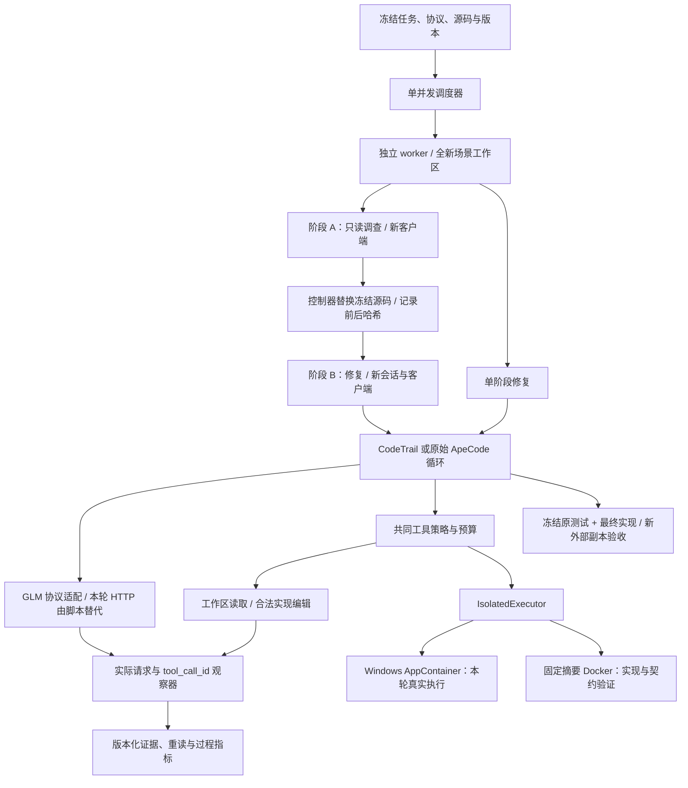

# 双 Agent 阶段调度与隔离执行

2026-11-06。继[离线基准接入](benchmark-program-offline.md)后，已把 CodeTrail/ApeCode 的原始循环、跨会话阶段、工具策略、隔离测试、实际请求观察器和外部验收串联。当前 CLI 是**离线脚本化集成检查**，没有付费 API 启动开关，也没有新增 Benchmark 题目或模型成绩。

## 架构



两个 worker 都使用固定 Python 3.13.11，满足上游 ApeCode 要求，减少旧横评中 Python 版本差异。ApeCode 固定提交 `8d85a3929cac72665e96f10d1dcbcce2962ca49b`，不修改其原始循环或工具实现；系统模板只适配受限规则发现和固定时钟，工具调用经过外部策略。两者原生提示、schema、上下文和记忆能力仍不同，不是单因素消融。

## 可复现离线命令

前提：现有项目 Python、固定 ApeCode 源码、Python 3.13.11；Windows AppContainer 可用。不需要模型 Key。每次使用新的输出目录。

```powershell
# 按需准备上游和统一 worker Python
git clone https://github.com/ApeCodeAI/apecode.git artifacts/cross-agent-sources/apecode
git -C artifacts/cross-agent-sources/apecode checkout 8d85a3929cac72665e96f10d1dcbcce2962ca49b
uv python install 3.13.11
$workerPython = uv python find 3.13.11

# 首次工具执行前冻结。仅控制器集成夹具，不读取 Benchmark 参考修复
python -X utf8 scripts/run_process_controller.py --output artifacts/my-process-controller --freeze --python $workerPython
python -X utf8 scripts/run_process_controller.py --output artifacts/my-process-controller --run

# 独立读取原轨迹、重新安装冻结测试并在 AppContainer 内复验
python -X utf8 scripts/audit_process_controller.py --batch artifacts/my-process-controller --output artifacts/my-process-audit --reverify
```

两个夹具分别检查单阶段加法修复与跨会话限额变化；每个 Agent 各两次，共 8 个场景运行、12 个会话。它们不是自建 12 题数据集的新题，不计入任何模型成功率。故障、补丁失配及后续动作由脚本事先安排；只验证实际循环与工具链路，不证明模型会自主选择这些动作。

整个 worker 中 `urllib.request.urlopen` 被断网式脚本替代：只接受冻结标准 API URL，其他 HTTP 操作直接拒绝；继承环境会过滤真实密钥，内部仅注入无效的测试字符串。不会连接 Coding Plan，不伪装其他客户端，不使用外部模型。Thinking 和 native tool_calls 是离线合同，不能当作服务端支持的实际确认。

`freeze.json` 同时约束任务、计划、协议、源码、源代码归档与上游/worker 版本；修改后拒绝续跑原批次。已派发但未生成结果的目录保留为中断失败，不替换；所有槽位都有目录但仍有中断时，不标记为 complete。worker 墙钟上限 **645 秒/整个场景**，不宣称额外实现了每阶段 300 秒的硬截止。

## 过程证据及统计

- `session-a/`、`session-b/`：完整实际请求、响应、工具参数/结果和 `process/events.jsonl`；只读阶段不继承必须通过修复测试的结束要求。
- `execution/`：逐次内核执行审计；`independent-final/`：由冻结测试和最终合法实现新建的外部副本；`changes.diff` 和 `final-workspace/` 保留最终状态。
- `runs.json`、`runs.csv`：逐场景记录，拆分功能/流程、失败分类、会话数、工具步数和时间。脚本化请求的 Token 未观测，不按 0 计费，不计算总分。
- 新审计 `policy_denials` 只计策略/审批拒绝；`dispatch_rejections` 另计所有被标记拒绝的派发，其中包含参数错误。底层旧字段 `session-result.security_denials` 沿用通用函数的宽口径，按 dispatch rejection 理解，不能当作攻击拦截数。
- 补丁失败按明确错误或 ApeCode 的 `no replacements made` 判断；后续同文件成功且真实字节发生变化才计作纠正。原始工具文本不改写；分类不会给 ApeCode 注入 CodeTrail 的纠错策略。
- Context 指标只计成功编号读取、准确来源版本及实际出站 tool 帧，不从最终回答推断；当前不覆盖 search、语义改写或记忆采纳。重复读取包括故意安排的补丁失败后重读，不应直接理解为无效开销。
- 只读阶段和修复阶段各自使用相应冻结源码版本作为证据代理。多会话场景只延续自身工作区中的原生知识，不复制其他场景或旧对话；文字候选记忆不自动批准。ApeCode 缺少原生持久记忆时明确记为不支持，不暗中植入 CodeTrail 记忆。

失败请求和所有耗时属于原运行。协议观察器将截断、缺失 Thinking 字段、解析器未派发的原生调用单独记录；它不把解析器已正确拒绝的调用误认为缺少工具回包。该检查不等于覆盖所有协议错误或语义忠实性。

## Docker 后端的边界

`IsolatedExecutor('docker', ..., image='<真实镜像>@sha256:<摘要>')` 只接受不可变镜像、精确 unittest 命令和有限超时。执行前要求 Linux daemon 及本地镜像 digest 一致；不自动拉取。输入先经相同过滤规则复制，只读挂载该副本；容器禁网、只读根目录、丢弃 capabilities、禁止提权、非 root、限制 PID/内存/CPU，不继承宿主密钥。不存在宿主执行回退。

容器启动前保存随机 nonce lease；超时或中断后只清理该次 lease 对应的容器。无法确认清理时，拒绝下一次工具及模型请求并停止派发。其他用户容器名或不安全 lease 路径会被拒绝。模板命令、不可用分支及清理行为通过契约测试；**本机没有 Docker，尚无 Docker 内核执行结果**。

这只是自建 unittest 场景的隔离后端，不能代替 SWE-bench 仓库环境和官方验收。公开基准还需官方镜像资格验证、实际容器推理环境与固定仓库测试入口。不要把 AppContainer 的本次通过结果改标为 Docker 或 SWE-bench 成绩。

依据：[Docker 运行与资源约束](https://docs.docker.com/engine/containers/run/)、[只读绑定挂载](https://docs.docker.com/engine/storage/bind-mounts/)。镜像摘要及平台需实际核对，文档模板中的示例摘要不是已验证环境。

## 仍需完成

当前两个 Agent 的调用/回调接口已经贯通。面向自建数据集和公开子集的**付费正式调度**仍需接入已授权的标准 API、实际协议预检、金额预算门控、镜像及标签审查和完整正式冻结。当前 CLI 不提供绕过这些条件的 live 模式。Hugging Face 仍为本地草案。

最终本轮证据见[控制器集成报告](../validation/process-controller-2026-11-06/report.md)；此前原始批次、测试失败与审计修订均保留。
